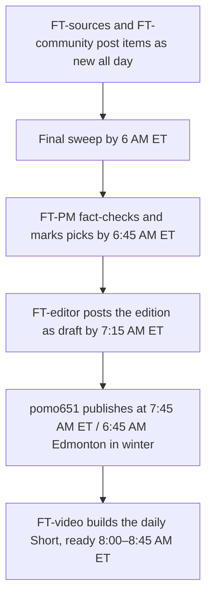

# Funded Tape

Funded Tape is a daily newsletter for prop firm traders. Each issue is the things you can't miss in the prop firm world that day: what changed, why it matters, and the source.

## Roadmap

- **Alpha:** a free daily issue of "the things you can't miss in the prop firm world today," published at https://prop-firm-newsletter.vercel.app/daily. Sent on [Beehiiv](https://www.beehiiv.com/)'s free plan.
- **Beta:** the same daily issue, plus one YouTube video and Shorts.

## Daily workflow

The newsletter and the Short are daily. Each edition covers the 24 hours up to 6 AM ET. Full write-up: [`plan/WORKFLOW.md`](plan/WORKFLOW.md). Item format: [`plan/DATA_FORMAT.md`](plan/DATA_FORMAT.md).

1. All day, with a final sweep by **6 AM ET**: FT-sources and FT-community post every item as `new`.
2. By **6:45 AM ET**: FT-PM fact-checks against the firm's own page and marks picks (about 3 on a weekday, proposed). Picks show on the public home page immediately, so only mark one after the check.
3. By **7:15 AM ET**: FT-editor posts the edition as status `draft`.
4. At **7:45 AM ET** (6:45 AM Edmonton in winter): pomo651 approves and publishes. The approval window is about 6:15 to 6:45 AM Edmonton. Bots never publish.
5. After that: FT-video builds the daily Short from the published edition. It is ready around **8:00–8:45 AM ET**, once pomo651 has approved the edition. Nothing is uploaded without that approval.

pomo651 confirmed this early-morning timetable as the first test (Nov 25, 2026). The first live edition is targeted for Friday Nov 27, 2026 (Thursday Nov 26 is US Thanksgiving). An evening edition (cutoff around 5 PM ET) remains an option to test later, using open and click data. Still open: whether to skip weekends, and whether a weekly Beehiiv recap continues.

## Bot team

Roles, handoffs, and site rules are in [`plan/TEAM.md`](plan/TEAM.md). In short:

- **FT-PM** (formerly KFC) runs the project, owns the source list, fact-checks items, and marks picks.
- **FT-sources** (formerly Feed) covers official firm sites, help centers, and announcements.
- **FT-community** (formerly Pulse) covers X, Reddit, YouTube, Discord, and reviews.
- **FT-editor** (formerly Editor) writes the daily draft and posts it as status `draft`.
- **FT-video** (formerly Reel) builds the daily Short from the published edition.
- **Drew** owns the repo, infra, and docs.
- **pomo651** owns website development and is the only one who publishes or uploads.

The GitHub repo is the source of truth. Nothing sends or uploads until pomo651 approves it.

## Layout

- `plan/` — static CEO plan and team docs. Version 1 (Nov 1, 2026) is `plan/prop-firm-ceo-plan-v1.html`. Rebuild it with `python3 scripts/build_html.py`. Daily workflow: [`plan/WORKFLOW.md`](plan/WORKFLOW.md). Item format: [`plan/DATA_FORMAT.md`](plan/DATA_FORMAT.md). Roles and handoffs: [`plan/TEAM.md`](plan/TEAM.md).
- `editions/` — newsletter issues. `editions/2026-10-26_11-01-demo.txt` is a practice draft that was never sent. FINAL drafts of weekly editions #1–#3 are here too (no confirmed send on record; see [`cutoffs.md`](cutoffs.md)); see **Archive / newsletter files**.
- `research/` — background notes. `research/platform-pricing-2026-11-03.txt` is the platform check that chose Beehiiv's free plan.
- `scripts/` — helpers. `scripts/build_html.py` generates the plan HTML. Edition and screenshot builders live here too.
- `site/` — the Funded Tape website (Next.js on Vercel). See **Website** below.
- `supabase/migrations/` — database schema for the website.
- `designs/`, `video/`, `proposals/`, `reports/` — template explorations, the Shorts pipeline, strategy proposals, and status reports. See **Archive / newsletter files**.
- `funded-tape-template.html`, `cutoffs.md`, `send-schedule.md` — the Design B email template and the old weekly window/send schedule.

Future editions use `editions/YYYY-MM-DD.md`, named for the day the issue covers (the demo file keeps its old weekly name).

## Website (added Nov 25, 2026)

Live: **https://prop-firm-newsletter.vercel.app** (Vercel project `prop-firm-newsletter`, root directory `site/`).

| Page | What it shows |
|---|---|
| `/` Home | How Funded Tape works: a live animation (many sources → a few picks → the newsletter), live counters (sources, items, picks, editions) and the latest picks. It refreshes every 30 seconds. |
| `/daily` Daily newsletter | Published editions, newest first. One page per edition at `/daily/YYYY-MM-DD`. |

The left sidebar has only these two pages for now.

**How bots feed it.** The site reads from a database. Bots write to it through `POST /api/bot/sources`, `/api/bot/items` and `/api/bot/editions` with a bearer token. Full guide: [`site/BOT_API.md`](site/BOT_API.md).

**Rules that change for the bot team**

1. Anything marked `picked` appears on the public home page right away. Pick only fact-checked items.
2. Editions are posted as `draft`. Only the owner publishes one, so "nothing goes out until the owner approves" still holds on the site.
3. The newsletter is **daily** (owner confirmed Nov 25, 2026). The `editions/*.txt|md` files remain the working drafts. Post the final version to `/api/bot/editions` too.

**Database.** Supabase project `blackout-clock` (ref `fqgryxjuecjgelcjdvmq`), schema `funded_tape` (tables `sources`, `items`, `editions`). The site never touches blackout-clock's own tables. It reaches the data only through `public.ft_*` functions, which only the server key can call. Schema: `supabase/migrations/20261125000000_funded_tape_site.sql`.

**Seeded data.** 71 sources from the plan's source map, plus the 13 source links and 5 picks from the demo edition. The demo edition itself (dated 2026-11-01) is stored as a **draft**, because it was never approved.

**Env vars** (Vercel production + preview, and `site/.env.local` locally; names in `site/.env.example`): `SUPABASE_URL`, `SUPABASE_SERVICE_ROLE_KEY`, `BOT_TOKEN`, `PREVIEW_KEY`.

**Run locally:** `cd site && npm install && npm run dev`. **Deploy:** `cd site && vercel deploy --prod`.

## Archive / newsletter files

Synced from the team's local working copy on Nov 25, 2026. These files had not been committed after the initial repo layout.

- `editions/` also holds the FINAL drafts of editions #1 (Nov 8), #2 (Nov 16), and #3 (Nov 22): markdown, HTML, Beehiiv-clean HTML, a desktop preview PNG, and notes to FT-PM (filenames still say KFC), plus the Nov 6–7 verify-for-kfc notes. **Editions #1–#3 were drafted for the old weekly cadence. There is no confirmed send on record; see [`cutoffs.md`](cutoffs.md).**
- `funded-tape-template.html` and `designs/` — the Design B email template and the A–D design explorations (HTML + desktop/mobile previews).
- `video/` — Shorts pipeline code and small assets (`build.sh`, `render.py`, `make_audio.py`, template, cover, script, metadata). Large rendered MP4s are not stored in the repo.
- `proposals/` and `reports/` — the video/newsletter content-strategy proposal and the Nov 25 status report.
- `cutoffs.md` and `send-schedule.md` — the weekly edition windows and test-send schedule (historical; the newsletter is now daily).
- `scripts/build_*.py` and `scripts/shoot.py` — builders that produced the edition HTML and screenshots. They were moved here from the local working copy; `scripts/build_html.py` (the plan builder already in the repo) was left unchanged.
